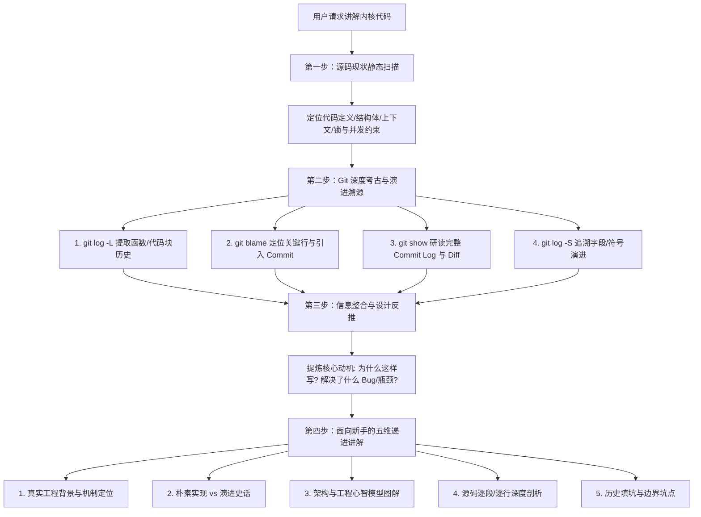

# Linux 内核代码深度讲解与演进追溯指南 (kernel-code-explainer)

Linux 内核代码具有高度的紧凑性、并发复杂性与历史沉淀。许多看似晦涩的判断条件、内存屏障、锁机制或字段，其真正的设计动机往往隐藏在 **Git 历史提交（Commit Message 与 Diff）** 中。

本 Skill 的核心目标是：**引导 Agent 收集全维度的信息（源码现状 + Git 历史演进 + 架构动机），基于真实的操作系统与硬件机理，以严谨清晰、层层递进的方式向初学者讲透内核代码。**

> [!IMPORTANT]
> **拒绝牵强的生活化类比**：
> 内核机制紧贴硬件与并发物理现实（多核 Cache 一致性、MMU 虚拟内存映射、中断抢占、内存乱序等）。生活化类比往往失真且难以映射到具体工程细节，反而增加理解负担。
> 讲解必须**立足于真实的操作系统与硬件工程场景**，用清晰的技术语言、精准的心智模型（时序图/状态机）以及演进背景来化繁为简。

---

## 核心工作流概览



---

## 第一阶段：源码现状静态扫描（Static Context Discovery）

在讲解前，首先全面摸清代码在当前仓库中的现状：

1. **精确定位代码位置与签名**：
   - 使用 `grep_search` 或 `find_by_name` 找到函数、结构体、宏的真实定义位置。
   - 使用 `view_file` 查看完整函数体及所在文件的前后上下文。
2. **识别内核执行上下文与约束**：
   - **执行上下文**：处于硬件中断上下文（Hardirq）、软中断/Tasklet（Softirq）、工作队列/内核线程（Process context）还是原子上下文？
   - **并发与锁机制**：是否持有 Spinlock、Mutex、RCU read-side critical section？是否有 `rcu_read_lock()` / `spin_lock_irqsave()`？
   - **内存语义与优化**：是否有 `READ_ONCE()` / `WRITE_ONCE()`、内存屏障（`smp_mb()`, `smp_rmb()`, `smp_wmb()`）、`likely()` / `unlikely()` 分支预测宏？
3. **梳理调用链路与核心数据结构**：
   - 搞清楚上游由谁调用（Entry points），下游调用了哪些关键辅助函数。
   - 关注核心结构体字段的生命周期（如引用计数 `refcount_t` / `kref`、状态标志位 `flags`）。

---

## 第二阶段：Git 深度考古与演进追溯（Git Archaeology）

> [!IMPORTANT]
> **绝对不要只凭当前的几行代码臆测作者的设计意图！**
> Linux 内核 Maintainer 和提交者会在 Commit Message 中详细解释：**遇到了什么 Bug、发生了何种竞态、为什么以前的方案行不通、为什么选择现在的方案**。必须主动使用 Git 命令挖掘这些黄金信息。

参考详细命令手册：[Git 考古速查指南](./references/git-archeology-guide.md)

### 1. 函数演进全生命周期（`git log -L`）
追踪目标函数的完整修改历史（包括修改原因和代码变化）：
```bash
# 追踪某个函数的变更历史
git log -L :<function_name>:<file_path> --stat
```

### 2. 精准定位疑难逻辑与关键行引入者（`git blame`）
对晦涩的 `if` 条件、特殊的锁释放顺序或内存屏障，定位其引入 Commit：
```bash
# -w 忽略空白，-C -C -C 跨文件/代码移动追踪
git blame -w -C -C -C -L <start_line>,<end_line> <file_path>
```

### 3. 研读完整的 Commit Message 与变更 Diff（`git show`）
获取关键 Commit 的完整内容：
```bash
git show --stat -p <commit_hash>
```
**重点关注 Commit Message 中的关键段落**：
- **Problem Statement**: 明确记录的并发竞争、死锁、硬件缺陷或性能断崖。
- **Root Cause**: 问题的本质物理/逻辑成因（如多核缓存行失效、TLB 刷新丢失、中断重入破坏共享数据）。
- **Solution & Invariants**: 为什么采用当前的加锁顺序、为什么引入新的标志位或内存屏障。
- **Fixes 标签 / Reported-by / LKML 讨论线索**。

### 4. 追溯结构体字段/标志位演进（`git log -S` / `git log -G`）
查找某个字段、枚举值或宏是在何时被引入或废弃的：
```bash
# 查找符号首次出现或变动的 commit
git log -S "<symbol_name>" --oneline <file_path>
```

---

## 第三阶段：信息整合与设计反推（Synthesizing Design Rationale）

将收集到的“当前代码”与“历史 Commit 信息”进行综合，回答以下核心问题：
1. **原始诉求**：这个函数/机制最初是为了解决操作系统的什么底层问题而诞生的？
2. **演进动因**：它经历了哪些重构？为什么初期的朴素版本在真实硬件/多核并发/高吞吐场景下无法支撑？
3. **细节防范**：代码里特殊的条件判断、标志位翻转、内存屏障，分别是为了防范什么具体的极端场景（Race Condition / Deadlock / Memory Order）？

---

## 第四阶段：面向新手的五维递进讲解范式（Novice-Friendly Pedagogy）

参考教学方法论手册：[面向新手的讲解范式与原则](./references/kernel-pedagogy-guide.md)

向新手讲解时，严格遵循以下结构组织输出：

### 1. 真实工程背景与机制定位（精准定义）
- **子系统角色**：清楚说明该函数在内核子系统（调度/内存/VFS/驱动/网络）中所处的层级与职责。
- **输入输出与核心目标**：明确输入参数含义、执行后的状态变更、返回值意义。
- **严禁使用脱离工程实际的生活类比**，直接用清晰简明的操作系统专业术语定义问题。

### 2. 演进史话（从“朴素实现”到“现代架构”）
- **朴素版本（Naive Implementation）**：给出如果用最直观、最简单的思路编写该功能时的原型代码。
- **真实硬件与多核下的缺陷**：引用 Git 历史中记录的典型问题（如单锁导致的多核吞吐瓶颈、缺少内存屏障导致的乱序读取、中断重入死锁）。
- **现代架构的形成**：解释 Commit 中作者是如何一步步演进、引入精细化机制（细粒度锁/RCU/无锁原子状态机）的。

### 3. 架构与工程心智模型图解（可视化）
- 使用 **Mermaid 流程图 / 时序图 / 状态机** 或 ASCII 结构图，直观展示数据流转与状态迁移。
- 标明核心涉及的数据结构（如 `task_struct`, `rq`, `wait_queue_head`）及它们之间的指针与引用关系。

### 4. 源码逐段深度剖析（庖丁解牛）
- 按照逻辑段落划分代码块，进行细致的代码解析。
- **解构内核黑魔法**：主动解释遇到的内核宏（如 `container_of`、`list_for_each_entry_rcu`）、内存模型辅助（如 `READ_ONCE`、`smp_mb__after_atomic`）。
- **锁与并发说明**：明确指出每一把锁锁的是什么数据、保护的临界区范围、为什么使用某种特定的锁变体（如 `spin_lock_irqsave` vs `spin_lock`）。

### 5. 历史填坑与边界细节（引用 Commit 释疑）
- 针对新手最容易困惑的边缘 `if` 条件或特殊防御逻辑，展示其背后的 Git 历史来源。
- 示例：“大家看到这里有个看似多余的 `if (!val) return;`，在 commit `abcd1234` 中作者记录到：在特定 NUMA 架构热插拔 CPU 时会触发空指针引用，因此合入了这行防御性检查。”

### 6. 新手知识延伸与底层原理补齐
- 主动梳理该函数涉及的前置核心概念（如原子上下文不能睡眠、RCU 宽限期、CPU 缓存一致性）。
- 提供 1~2 个启发性思考问题，加深理解。

---

## 示范参考

请查阅完整案例示范：[示范讲解案例与输出模板](./examples/case-study-explanation.md)
