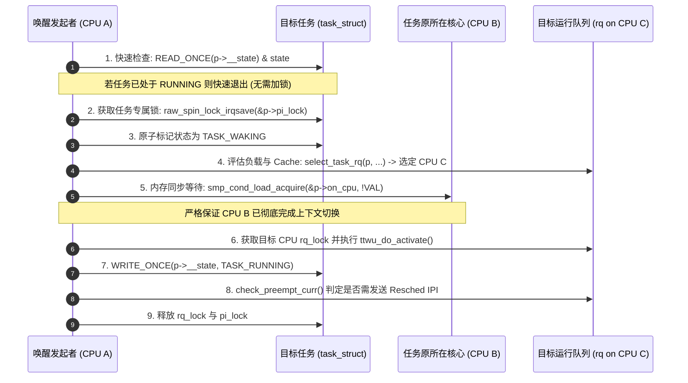

# 内核代码深度讲解示范案例与输出模板 (Case Study & Output Template)

本文件提供一个标准的讲解输出模板，并以内核核心调度唤醒机制 `try_to_wake_up()` 为例，展示严格立足于真实操作系统工程机制与 Git 历史演进的高质量输出示范。

---

## 讲解输出标准模板

```markdown
# 深入剖析：[函数名 / 机制名]

## 1. 真实工程背景与机制定位 (OS Context & Role)
- **子系统角色**：说明该函数在内核子系统（调度/内存/VFS/中断等）中的层级与定位。
- **输入、输出与核心目标**：准确定义入参、返回值以及核心解决的底层操作系统/硬件资源协调问题。

## 2. 演进史话与设计动机 (Git 考古揭秘)
- **朴素工程实现**：展示如果用最简单、直观的思路实现该功能时的原型代码。
- **多核并发与硬件约束下的缺陷**：剖析单锁瓶颈、Cache 颠簸、中断重入或内存乱序等真实缺陷。
- **现代设计的诞生**：引用 Commit [hash] ("...") 阐述作者是如何解决这一问题的。

## 3. 架构与工程心智模型 (可视化图解)
- 配合 Mermaid / ASCII 时序图、状态机或内存数据结构图，精准呈现状态迁移与并发时序。

## 4. 源码逐段深度剖析 (庖丁解牛)
- 贴出核心代码段（附带关键行号与文件路径）。
- 拆解内核宏、锁操作、原子语义与内存屏障。
- 标明隐式约束（如上下文要求、是否可睡眠、锁保护范围）。

## 5. 历史填坑与边界细节 (Commit 溯源)
- 重点解释疑难 `if` 判断、异常处理分支对应的真实历史 Bug 修复（引用具体 commit 与作者说明）。

## 6. 新手知识延伸与底层原理补齐
- 提炼 1~2 个关键底层概念（如不可睡眠原子上下文、内存可见性与全序）。
- 提供启发式技术思考题。
```

---

## 完整实战示范案例：剖析 `try_to_wake_up()` 唤醒机制

以下为一个实际讲解范例：

---

### 1. 真实工程背景与机制定位

- **子系统角色**：
  `try_to_wake_up(struct task_struct *p, unsigned int state, int wake_flags)` 是 Linux 调度器子系统（`kernel/sched/core.c`）中负责将处于阻塞/睡眠状态的任务恢复为可运行状态的核心入口。
- **核心目标与职责**：
  1. **状态校验与转换**：原子性地验证任务当前状态是否与传入的 `state` 掩码匹配（如 `TASK_INTERRUPTIBLE` / `TASK_UNINTERRUPTIBLE`），并将其转换为 `TASK_WAKING` / `TASK_RUNNING`。
  2. **目标 CPU 放置（CPU Placement）**：在 SMP 多核架构下，根据 CPU 拓扑、负载均衡、缓存局部性（Cache Locality）以及唤醒标志（`wake_flags`），为任务挑选最合适的 CPU 运行队列（`rq`）。
  3. **加入运行队列并触发抢占**：将任务挂入目标 CPU 的 `runqueue`（如 CFS 调度实体的红黑树），并在必要时向目标 CPU 发送调度 IPI 中断以触发抢占。

---

### 2. 演进史话与设计动机 (Git 考古揭秘)

#### 早期朴素实现及其致命缺陷：
如果仅从单核思维出发，唤醒任务的代码极其简单：
```c
/* 朴素原型：无法在现代 SMP 多核并发下安全运行 */
p->state = TASK_RUNNING;
enqueue_task(rq, p);
```
但在现代多核 SMP 与高抢占架构下，这种朴素实现存在严重的并发缺陷：
1. **跨 CPU 执行竞态（Multi-core Concurrency Hazard）**：
   任务原本在 CPU A 上运行并进入睡眠，此时 CPU B 执行唤醒操作，并决定将该任务迁移到空闲的 CPU C 上运行。如果缺乏严格的原子同步，CPU A 可能尚未彻底完成该任务的上下文切换（内核栈与硬件寄存器状态仍在使用），而 CPU C 已经开始调度执行该任务，导致两个 CPU 核心并发访问同一份内核栈，瞬间破坏内存。
2. **睡眠-唤醒丢失竞态（Lost Wakeup Race）**：
   任务在 CPU A 上检测条件不满足正准备睡眠，但在修改状态与调用 `schedule()` 之间，CPU B 产生了唤醒事件并修改状态为 `TASK_RUNNING`。若编译器或 CPU 乱序执行了状态赋值，CPU A 仍可能用旧的睡眠状态覆盖 `RUNNING` 并进入睡眠，导致事件永久丢失。

#### Git 考古关键节点：
- **Commit 溯源**：在提交 `2553ec0` ("sched/core: Use READ_ONCE/WRITE_ONCE for task->state") 中，内核调度器维护者 Peter Zijlstra 详细论述了为何必须使用 `READ_ONCE()` 与内存屏障组合替代直接的状态赋值，以保证无锁快速路径（Fast Path）状态检查的单次内存可见性，杜绝编译器的指令重排。
- **引入 `p->on_cpu` 屏障机制**：早期重构提交引入了 `smp_cond_load_acquire(&p->on_cpu, !VAL)`，强制要求唤醒者必须忙等待直到原运行 CPU 彻底离开 `context_switch`，从硬件与调度器层面确保同一时刻一个 `task_struct` 绝不会在多个 CPU 上并发执行。

---

### 3. 架构与工程心智模型 (可视化时序图)



---

### 4. 源码逐段深度剖析

（以 `kernel/sched/core.c` 中的关键片段为例）

```c
static int
try_to_wake_up(struct task_struct *p, unsigned int state, int wake_flags)
{
	guard(raw_spinlock_irqsave)(&p->pi_lock);

	/* 步骤 1：无锁状态匹配验证 */
	if (!(READ_ONCE(p->__state) & state))
		goto out;

	trace_sched_waking(p);

	/* 步骤 2：判断任务是否已经在运行队列中 */
	if (READ_ONCE(p->on_rq) && ttwu_runnable(p, wake_flags))
		goto success;
```

#### 关键机制拆解：
1. **`guard(raw_spinlock_irqsave)(&p->pi_lock)`**：
   - **工程目的**：利用内核 RAII 宏安全获取 `task_struct` 的 `pi_lock`（优先级继承自旋锁）并屏蔽本地 CPU 中断。
   - **为什么是 raw_spinlock？**：在实时内核（PREEMPT_RT）补丁下，普通 `spinlock` 会转换为可睡眠的互斥量，但调度核心逻辑必须运行在绝对不能被调度的原子上下文，因此必须使用硬件级不可睡眠的 `raw_spinlock`。
2. **`READ_ONCE(p->__state)`**：
   - **工程目的**：阻止编译器将 `p->__state` 缓存在 CPU 寄存器中，确保从内存总线/L1/L2 Cache 获取多核共享的最新真值。
3. **`on_rq` 快速路径**：
   - **工程目的**：如果任务已经被其他并发事件唤醒并重新置入 `rq`，但尚未被调度器切换上 CPU，直接通过 `ttwu_runnable()` 快速退出，避免昂贵的重复入队与调度计算开销。

---

### 5. 历史填坑与边界细节 (Commit 溯源)

在深层激活逻辑中存在如下等待指令：
```c
smp_cond_load_acquire(&p->on_cpu, !VAL);
```
- **Git 历史背景**：
  在早期多核 SMP 内核重构中，出现过罕见的极端竞态：任务在 CPU0 上睡眠并正执行 `switch_to()` 切换到 `idle` 线程，此时 CPU1 执行唤醒并立即在 CPU1 上将该任务投入运行。由于硬件流水线和 TLB 刷新的微秒级延迟，该任务在 CPU0 和 CPU1 上发生了内核栈并发写操作，导致难以复现的内存静默损坏（Memory Corruption）。
- **提交修复**：
  引入 `p->on_cpu` 标志，任务原所在 CPU 必须在彻底完成硬件寄存器与内核栈切换后，才将 `on_cpu` 清零；唤醒 CPU 则通过 `smp_cond_load_acquire`（Acquire 内存语义屏障）忙等待直到该标志清零，从根本上杜绝了多核重叠执行。

---

### 6. 新手知识延伸与底层原理补齐

- **核心底层原则**：
  - **原子上下文约束**：`try_to_wake_up` 持有 `raw_spinlock` 且关闭中断，期间绝对不能调用任何可能引起阻塞/睡眠的函数（如 `mutex_lock`、`kmalloc(GFP_KERNEL)`），否则会导致 CPU 硬死锁（Hard Lockup）。
- **启发式技术思考**：
  - 为什么唤醒任务时首先加锁的是 `p->pi_lock`（任务级锁），而不是直接加目标 CPU 的 `rq->lock`（运行队列锁）？
  - *解答*：因为在调用 `select_task_rq()` 计算出目标 CPU 之前，任务所属的 `rq` 是未知的且可能被迁移；必须先锁定任务本身，才能安全地为其挑选并迁移运行队列。
